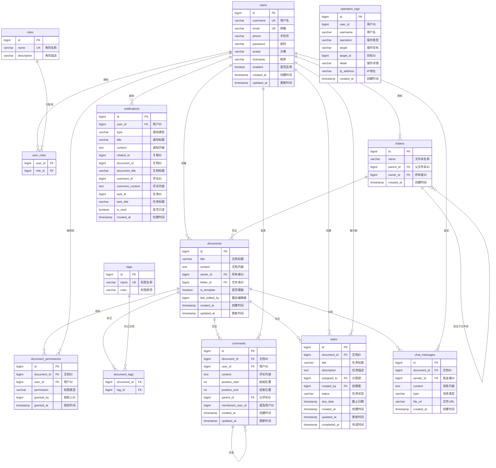

# 协作文档管理系统 - 数据库ER图

## ER图（Mermaid 格式）

---

## 表关系说明

### 一对多关系（1:N）

| 主表      | 从表                 | 关系说明                                 |
| --------- | -------------------- | ---------------------------------------- |
| users     | documents            | 一个用户可以创建多个文档                 |
| users     | folders              | 一个用户可以创建多个文件夹               |
| users     | comments             | 一个用户可以发表多条评论                 |
| users     | tasks                | 一个用户可以创建多个任务                 |
| users     | notifications        | 一个用户可以接收多条通知                 |
| users     | chat_messages        | 一个用户可以发送多条消息                 |
| documents | comments             | 一个文档可以有多条评论                   |
| documents | tasks                | 一个文档可以有多个任务                   |
| documents | document_permissions | 一个文档可以有多个权限记录               |
| documents | chat_messages        | 一个文档可以有多条聊天消息               |
| folders   | documents            | 一个文件夹可以包含多个文档               |
| folders   | folders              | 一个文件夹可以包含多个子文件夹（自关联） |
| comments  | comments             | 一条评论可以有多条回复（自关联）         |

---

### 多对多关系（M:N）

| 表1       | 中间表        | 表2   | 关系说明                                           |
| --------- | ------------- | ----- | -------------------------------------------------- |
| users     | user_roles    | roles | 一个用户可以有多个角色，一个角色可以分配给多个用户 |
| documents | document_tags | tags  | 一个文档可以有多个标签，一个标签可以标记多个文档   |

---

## 核心表详细说明

### 1. users（用户表）

**主键**：id**唯一键**：username, email**外键关系**：

- 创建 documents（owner_id）
- 拥有 folders（owner_id）
- 发表 comments（user_id）
- 创建/被分配 tasks（created_by, assigned_to）

---

### 2. documents（文档表）

**主键**：id**外键**：

- owner_id → users.id（所有者）
- folder_id → folders.id（所属文件夹）

**关联表**：

- document_permissions（权限）
- document_tags（标签）
- comments（评论）
- tasks（任务）

---

### 3. document_permissions（文档权限表）

**主键**：id**外键**：

- document_id → documents.id
- user_id → users.id

**权限类型**：OWNER, EDITOR, VIEWER

---

### 4. folders（文件夹表）

**主键**：id**外键**：

- parent_id → folders.id（自关联，父文件夹）
- owner_id → users.id（所有者）

**特点**：支持树形结构，无限层级

---

### 5. comments（评论表）

**主键**：id**外键**：

- document_id → documents.id
- user_id → users.id
- parent_id → comments.id（自关联，父评论）

**特点**：支持多级回复，形成评论树

---

### 6. tasks（任务表）

**主键**：id**外键**：

- document_id → documents.id
- assigned_to → users.id（被分配者）
- created_by → users.id（创建者）

**状态枚举**：TODO, IN_PROGRESS, COMPLETED, CANCELLED

---

### 7. notifications（通知表）

**主键**：id**外键**：

- user_id → users.id（接收者）

**通知类型**：DOCUMENT_SHARED, COMMENT_ADDED, TASK_ASSIGNED 等

---

## 数据库约束

### 主键约束（PRIMARY KEY）

所有表都有自增主键 `id`

### 唯一约束（UNIQUE）

- users.username
- users.email
- roles.name
- tags.name

### 非空约束（NOT NULL）

- users: username, password
- documents: title, owner_id
- comments: document_id, user_id, content
- tasks: document_id, title, created_by

### 外键约束（FOREIGN KEY）

所有外键字段都有对应的外键约束，确保引用完整性

### 默认值（DEFAULT）

- users.enabled = true
- documents.is_template = false
- tasks.status = 'TODO'
- notifications.is_read = false

---

## 索引设计

### 主键索引

所有表的 `id` 字段自动创建主键索引

### 唯一索引

- users(username)
- users(email)
- roles(name)
- tags(name)

### 外键索引

- documents(owner_id)
- documents(folder_id)
- document_permissions(document_id, user_id)
- comments(document_id, user_id)
- tasks(document_id, assigned_to, created_by)
- notifications(user_id)

### 复合索引（建议）

- documents(owner_id, updated_at) - 用于查询用户文档列表
- comments(document_id, created_at) - 用于查询文档评论
- tasks(document_id, status) - 用于查询文档任务

---

## 数据完整性

### 参照完整性

通过外键约束保证：

- 删除用户时，需要先处理其创建的文档、评论、任务
- 删除文档时，级联删除相关的权限、评论、任务

### 实体完整性

通过主键约束保证每条记录唯一

### 域完整性

通过数据类型、非空约束、默认值保证数据有效性

---

## 使用说明

### 在线渲染

1. 访问 https://mermaid.live/
2. 复制上面的 Mermaid 代码
3. 粘贴到编辑器
4. 导出为 PNG/SVG

### VS Code 预览

1. 安装 "Markdown Preview Mermaid Support" 插件
2. 打开此文件
3. 按 Ctrl+Shift+V 预览
4. 截图保存

### 导出到 Word

1. 使用上述方法生成图片
2. 在 Word 中插入图片
3. 添加表关系说明

---
## 数据表详细设计（表格格式）

### users（用户表）

**表说明**：本表记录系统所有用户的基本信息和账号状态

| 中文字段名 | 英文字段名 | 类型 | 约束 | 备注 |
|-----------|-----------|------|------|------|
| 用户ID | id | bigint | NOT NULL, PK | 主键，自增 |
| 用户名 | username | varchar(50) | NOT NULL, UNIQUE | 唯一，用于登录 |
| 邮箱 | email | varchar(100) | UNIQUE | 唯一，可选 |
| 手机号 | phone | varchar(20) | NULL | 可选 |
| 密码 | password | varchar(255) | NOT NULL | BCrypt加密存储 |
| 头像 | avatar | varchar(255) | NULL | 头像URL |
| 昵称 | nickname | varchar(50) | NULL | 显示名称 |
| 是否启用 | enabled | boolean | NOT NULL, DEFAULT true | true=启用，false=禁用 |
| 创建时间 | created_at | timestamp | NOT NULL | 自动记录 |
| 更新时间 | updated_at | timestamp | NOT NULL | 自动更新 |
---
### documents（文档表）

| 中文字段名 | 英文字段名     | 类型         | 约束                    | 备注                      |
| ---------- | -------------- | ------------ | ----------------------- | ------------------------- |
| 文档ID     | id             | bigint       | NOT NULL, PK            | 主键，自增                |
| 文档标题   | title          | varchar(255) | NOT NULL                | 文档标题                  |
| 文档内容   | content        | text         | NULL                    | 支持大文本                |
| 所有者ID   | owner_id       | bigint       | NOT NULL, FK            | 外键关联users.id          |
| 文件夹ID   | folder_id      | bigint       | NULL, FK                | 外键关联folders.id        |
| 是否模板   | is_template    | boolean      | NOT NULL, DEFAULT false | true=模板，false=普通文档 |
| 最后编辑者 | last_edited_by | bigint       | NULL                    | 记录最后编辑用户ID        |
| 创建时间   | created_at     | timestamp    | NOT NULL                | 自动记录                  |
| 更新时间   | updated_at     | timestamp    | NOT NULL                | 自动更新                  |

---

### document_permissions（文档权限表）

| 中文字段名 | 英文字段名  | 类型        | 约束         | 备注                                       |
| ---------- | ----------- | ----------- | ------------ | ------------------------------------------ |
| 权限ID     | id          | bigint      | NOT NULL, PK | 主键，自增                                 |
| 文档ID     | document_id | bigint      | NOT NULL, FK | 外键关联documents.id                       |
| 用户ID     | user_id     | bigint      | NOT NULL, FK | 外键关联users.id                           |
| 权限类型   | permission  | varchar(20) | NOT NULL     | OWNER=所有者，EDITOR=编辑者，VIEWER=查看者 |
| 授权人ID   | granted_by  | bigint      | NULL         | 记录谁授予的权限                           |
| 授权时间   | granted_at  | timestamp   | NOT NULL     | 自动记录                                   |

---

### roles（角色表）

**表说明**：本表记录系统角色类型，用于基于角色的访问控制（RBAC）

| 中文字段名 | 英文字段名  | 类型         | 约束             | 备注                                                      |
| ---------- | ----------- | ------------ | ---------------- | --------------------------------------------------------- |
| 角色ID     | id          | bigint       | NOT NULL, PK     | 主键，自增                                                |
| 角色名称   | name        | varchar(50)  | NOT NULL, UNIQUE | ROLE_ADMIN=管理员，ROLE_EDITOR=编辑者，ROLE_VIEWER=查看者 |
| 角色描述   | description | varchar(255) | NULL             | 角色说明                                                  |

---

### comments（评论表）

**表说明**：本表记录文档的评论信息，支持多级回复形成评论树

| 中文字段名 | 英文字段名        | 类型      | 约束         | 备注                          |
| ---------- | ----------------- | --------- | ------------ | ----------------------------- |
| 评论ID     | id                | bigint    | NOT NULL, PK | 主键，自增                    |
| 文档ID     | document_id       | bigint    | NOT NULL, FK | 外键关联documents.id          |
| 用户ID     | user_id           | bigint    | NOT NULL, FK | 外键关联users.id              |
| 评论内容   | content           | text      | NOT NULL     | 评论文本内容                  |
| 起始位置   | position_start    | int       | NULL         | 行内评论起始位置              |
| 结束位置   | position_end      | int       | NULL         | 行内评论结束位置              |
| 父评论ID   | parent_id         | bigint    | NULL, FK     | 外键关联comments.id，用于回复 |
| 提及用户ID | mentioned_user_id | bigint    | NULL         | @提及的用户ID                 |
| 创建时间   | created_at        | timestamp | NOT NULL     | 自动记录                      |
| 更新时间   | updated_at        | timestamp | NOT NULL     | 自动更新                      |

---

### tasks（任务表）

**表说明**：本表记录文档相关的任务信息，支持任务分配和状态管理

| 中文字段名 | 英文字段名   | 类型         | 约束                     | 备注                                                              |
| ---------- | ------------ | ------------ | ------------------------ | ----------------------------------------------------------------- |
| 任务ID     | id           | bigint       | NOT NULL, PK             | 主键，自增                                                        |
| 文档ID     | document_id  | bigint       | NOT NULL, FK             | 外键关联documents.id                                              |
| 任务标题   | title        | varchar(255) | NOT NULL                 | 任务名称                                                          |
| 任务描述   | description  | text         | NULL                     | 任务详细说明                                                      |
| 分配给     | assigned_to  | bigint       | NULL, FK                 | 外键关联users.id                                                  |
| 创建者     | created_by   | bigint       | NOT NULL, FK             | 外键关联users.id                                                  |
| 任务状态   | status       | varchar(20)  | NOT NULL, DEFAULT 'TODO' | TODO=待办，IN_PROGRESS=进行中，COMPLETED=已完成，CANCELLED=已取消 |
| 截止日期   | due_date     | timestamp    | NULL                     | 任务截止时间                                                      |
| 创建时间   | created_at   | timestamp    | NOT NULL                 | 自动记录                                                          |
| 更新时间   | updated_at   | timestamp    | NOT NULL                 | 自动更新                                                          |
| 完成时间   | completed_at | timestamp    | NULL                     | 任务完成时记录                                                    |

---

### notifications（通知表）

**表说明**：本表记录系统通知信息，支持实时推送和已读标记

| 中文字段名 | 英文字段名      | 类型         | 约束                    | 备注                                                                     |
| ---------- | --------------- | ------------ | ----------------------- | ------------------------------------------------------------------------ |
| 通知ID     | id              | bigint       | NOT NULL, PK            | 主键，自增                                                               |
| 用户ID     | user_id         | bigint       | NOT NULL, FK            | 外键关联users.id，接收通知的用户                                         |
| 通知类型   | type            | varchar(50)  | NOT NULL                | DOCUMENT_SHARED=文档分享，COMMENT_ADDED=新评论，TASK_ASSIGNED=任务分配等 |
| 通知标题   | title           | varchar(255) | NOT NULL                | 通知标题                                                                 |
| 通知内容   | content         | text         | NULL                    | 通知详细内容                                                             |
| 关联ID     | related_id      | bigint       | NULL                    | 关联对象的通用ID                                                         |
| 文档ID     | document_id     | bigint       | NULL                    | 关联的文档ID                                                             |
| 文档标题   | document_title  | varchar(255) | NULL                    | 冗余存储，避免关联查询                                                   |
| 评论ID     | comment_id      | bigint       | NULL                    | 关联的评论ID                                                             |
| 评论内容   | comment_content | text         | NULL                    | 冗余存储                                                                 |
| 任务ID     | task_id         | bigint       | NULL                    | 关联的任务ID                                                             |
| 任务标题   | task_title      | varchar(255) | NULL                    | 冗余存储                                                                 |
| 是否已读   | is_read         | boolean      | NOT NULL, DEFAULT false | true=已读，false=未读                                                    |
| 创建时间   | created_at      | timestamp    | NOT NULL                | 自动记录                                                                 |
