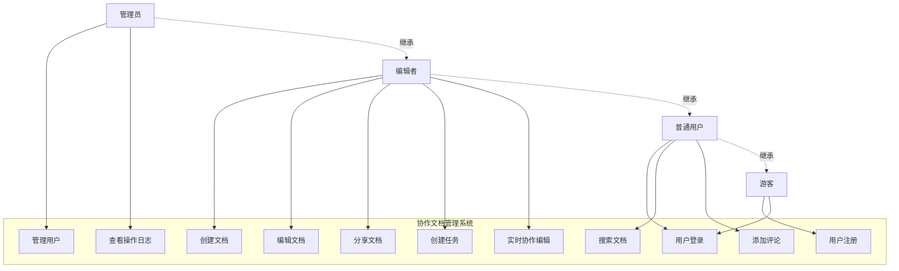

# 协作文档管理系统 - 用例图与用例表

## 1. 系统用例图

---

## 2. 主要用例表

### 用例1：用户注册

| 项目               | 内容                                                                                                                                                                                                       |
| ------------------ | ---------------------------------------------------------------------------------------------------------------------------------------------------------------------------------------------------------- |
| **用例编号** | UC-001                                                                                                                                                                                                     |
| **用例名称** | 用户注册                                                                                                                                                                                                   |
| **参与者**   | 游客                                                                                                                                                                                                       |
| **前置条件** | 用户未登录系统                                                                                                                                                                                             |
| **后置条件** | 创建新用户账号，自动分配查看者角色                                                                                                                                                                         |
| **主要流程** | 1. 用户访问注册页面` `2. 输入用户名、邮箱、密码等信息` `3. 系统验证数据格式和唯一性` `4. 系统加密密码并保存用户信息` `5. 系统分配默认角色（VIEWER）` `6. 注册成功，跳转到登录页面 |
| **异常流程** | 3a. 用户名已存在，提示"用户名已被使用"` `3b. 邮箱已存在，提示"邮箱已被使用"` `3c. 数据格式不正确，提示相应错误信息                                                                               |
| **业务规则** | - 用户名长度：3-20字符` `- 密码长度：6-40字符` `- 邮箱必须符合标准格式` `- 密码使用 BCrypt 加密存储                                                                                         |

---

### 用例2：用户登录

| 项目               | 内容                                                                                                                                                                                                                   |
| ------------------ | ---------------------------------------------------------------------------------------------------------------------------------------------------------------------------------------------------------------------- |
| **用例编号** | UC-002                                                                                                                                                                                                                 |
| **用例名称** | 用户登录                                                                                                                                                                                                               |
| **参与者**   | 游客、普通用户、编辑者、管理员                                                                                                                                                                                         |
| **前置条件** | 用户已完成注册                                                                                                                                                                                                         |
| **后置条件** | 用户登录成功，获得 JWT Token，进入系统                                                                                                                                                                                 |
| **主要流程** | 1. 用户访问登录页面` `2. 输入用户名和密码` `3. 系统验证用户名和密码` `4. 系统生成 JWT Token` `5. 返回 Token 和用户基本信息` `6. 前端保存 Token 到 sessionStorage` `7. 跳转到文档列表页面 |
| **异常流程** | 3a. 用户名不存在，提示"用户不存在"` `3b. 密码错误，提示"密码错误"` `3c. 账号被禁用，提示"账号已被禁用"                                                                                                       |
| **业务规则** | - Token 有效期：24小时` `- 使用 sessionStorage 实现标签页隔离` `- 每个浏览器标签页独立登录状态                                                                                                               |

---

### 用例3：创建文档

| 项目               | 内容                                                                                                                                                                                                                                |
| ------------------ | ----------------------------------------------------------------------------------------------------------------------------------------------------------------------------------------------------------------------------------- |
| **用例编号** | UC-003                                                                                                                                                                                                                              |
| **用例名称** | 创建文档                                                                                                                                                                                                                            |
| **参与者**   | 编辑者、管理员                                                                                                                                                                                                                      |
| **前置条件** | 用户已登录且拥有编辑者或管理员角色                                                                                                                                                                                                  |
| **后置条件** | 创建新文档，用户自动成为文档所有者                                                                                                                                                                                                  |
| **主要流程** | 1. 用户点击"新建文档"按钮` `2. 输入文档标题和内容` `3. 选择文件夹（可选）` `4. 添加标签（可选）` `5. 点击保存按钮` `6. 系统创建文档记录` `7. 系统自动创建 OWNER 权限记录` `8. 跳转到文档编辑页面 |
| **异常流程** | 2a. 文档标题为空，提示"标题不能为空"                                                                                                                                                                                                |
| **业务规则** | - 创建者自动成为文档所有者` `- 文档内容支持大文本存储` `- 自动记录创建时间和更新时间                                                                                                                                      |

---

### 用例4：编辑文档

| 项目               | 内容                                                                                                                                                                                               |
| ------------------ | -------------------------------------------------------------------------------------------------------------------------------------------------------------------------------------------------- |
| **用例编号** | UC-004                                                                                                                                                                                             |
| **用例名称** | 编辑文档                                                                                                                                                                                           |
| **参与者**   | 编辑者、管理员                                                                                                                                                                                     |
| **前置条件** | 用户对文档拥有编辑权限（EDITOR 或 OWNER）                                                                                                                                                          |
| **后置条件** | 文档内容更新，记录最后编辑者信息                                                                                                                                                                   |
| **主要流程** | 1. 用户打开文档` `2. 系统检查用户的编辑权限` `3. 用户修改文档内容` `4. 系统自动保存（防抖500ms）` `5. 系统更新 lastEditedBy 字段` `6. 通过 WebSocket 实时通知其他在线用户 |
| **异常流程** | 2a. 用户无编辑权限，提示"没有编辑权限"并禁止编辑                                                                                                                                                   |
| **业务规则** | - 自动保存间隔：500毫秒` `- 记录最后编辑者ID` `- 实时同步给所有在线用户                                                                                                                  |

---

### 用例5：分享文档

| 项目               | 内容                                                                                                                                                                                                              |
| ------------------ | ----------------------------------------------------------------------------------------------------------------------------------------------------------------------------------------------------------------- |
| **用例编号** | UC-005                                                                                                                                                                                                            |
| **用例名称** | 分享文档                                                                                                                                                                                                          |
| **参与者**   | 编辑者、管理员                                                                                                                                                                                                    |
| **前置条件** | 用户是文档所有者                                                                                                                                                                                                  |
| **后置条件** | 目标用户获得文档访问权限，收到分享通知                                                                                                                                                                            |
| **主要流程** | 1. 用户打开文档` `2. 点击"分享"按钮` `3. 选择目标用户` `4. 选择权限类型（查看者/编辑者）` `5. 点击确认` `6. 系统创建权限记录` `7. 系统发送通知给目标用户` `8. 显示分享成功提示 |
| **异常流程** | 1a. 非文档所有者操作，提示"只有所有者可以分享文档"` `3a. 目标用户不存在，提示"用户不存在"                                                                                                                    |
| **业务规则** | - 只有文档所有者可以分享文档` `- 可以分享给多个用户` `- 每个用户可以设置不同的权限级别                                                                                                                  |

---

### 用例6：搜索文档

| 项目               | 内容                                                                                                                                                                                                         |
| ------------------ | ------------------------------------------------------------------------------------------------------------------------------------------------------------------------------------------------------------ |
| **用例编号** | UC-006                                                                                                                                                                                                       |
| **用例名称** | 搜索文档                                                                                                                                                                                                     |
| **参与者**   | 普通用户、编辑者、管理员                                                                                                                                                                                     |
| **前置条件** | 用户已登录                                                                                                                                                                                                   |
| **后置条件** | 显示符合搜索条件的文档列表                                                                                                                                                                                   |
| **主要流程** | 1. 用户在搜索框输入关键词` `2. 点击搜索按钮或按回车键` `3. 系统在文档标题和内容中进行模糊匹配` `4. 系统只返回用户有权限访问的文档` `5. 显示搜索结果列表` `6. 用户可点击文档查看详情 |
| **异常流程** | 3a. 未找到匹配文档，显示"未找到相关文档"                                                                                                                                                                     |
| **业务规则** | - 使用 LIKE 模糊匹配` `- 同时搜索标题和内容字段` `- 只返回当前用户有权限的文档                                                                                                                     |

---

### 用例7：添加评论

| 项目               | 内容                                                                                                                                                                                                                                      |
| ------------------ | ----------------------------------------------------------------------------------------------------------------------------------------------------------------------------------------------------------------------------------------- |
| **用例编号** | UC-007                                                                                                                                                                                                                                    |
| **用例名称** | 添加评论                                                                                                                                                                                                                                  |
| **参与者**   | 普通用户、编辑者、管理员                                                                                                                                                                                                                  |
| **前置条件** | 用户对文档有查看权限                                                                                                                                                                                                                      |
| **后置条件** | 创建评论记录，通知文档所有者                                                                                                                                                                                                              |
| **主要流程** | 1. 用户打开文档` `2. 在评论区输入评论内容` `3. 可选择回复某条评论` `4. 可选择 @提及其他用户` `5. 点击发送` `6. 系统创建评论记录` `7. 系统通过 WebSocket 实时推送给在线用户` `8. 系统创建通知给相关用户 |
| **异常流程** | 2a. 评论内容为空，提示"评论内容不能为空"                                                                                                                                                                                                  |
| **业务规则** | - 支持多级评论回复（树形结构）` `- 支持 @提及功能` `- 实时推送给在线用户` `- 通知文档所有者和被 @的用户                                                                                                                    |

---

### 用例8：创建任务

| 项目               | 内容                                                                                                                                                                                                                             |
| ------------------ | -------------------------------------------------------------------------------------------------------------------------------------------------------------------------------------------------------------------------------- |
| **用例编号** | UC-008                                                                                                                                                                                                                           |
| **用例名称** | 创建任务                                                                                                                                                                                                                         |
| **参与者**   | 编辑者、管理员                                                                                                                                                                                                                   |
| **前置条件** | 用户对文档有编辑权限                                                                                                                                                                                                             |
| **后置条件** | 创建任务记录，如有分配对象则发送通知                                                                                                                                                                                             |
| **主要流程** | 1. 用户打开文档` `2. 点击"添加任务"按钮` `3. 输入任务标题和描述` `4. 选择分配对象（可选）` `5. 设置截止日期（可选）` `6. 点击创建` `7. 系统创建任务记录` `8. 如有分配对象，发送通知给被分配者 |
| **异常流程** | 3a. 任务标题为空，提示"任务标题不能为空"                                                                                                                                                                                         |
| **业务规则** | - 任务默认状态：待办（TODO）` `- 可以分配给其他用户` `- 支持设置截止日期` `- 只有创建者和被分配者可以修改任务                                                                                                     |

---

### 用例9：实时协作编辑

| 项目               | 内容                                                                                                                                                                                                                                          |
| ------------------ | --------------------------------------------------------------------------------------------------------------------------------------------------------------------------------------------------------------------------------------------- |
| **用例编号** | UC-009                                                                                                                                                                                                                                        |
| **用例名称** | 实时协作编辑                                                                                                                                                                                                                                  |
| **参与者**   | 编辑者、管理员                                                                                                                                                                                                                                |
| **前置条件** | 用户对文档有编辑权限，WebSocket 连接正常                                                                                                                                                                                                      |
| **后置条件** | 文档内容实时同步给所有在线用户                                                                                                                                                                                                                |
| **主要流程** | 1. 用户A打开文档` `2. 建立 WebSocket 连接` `3. 订阅文档频道` `4. 用户A修改内容` `5. 系统防抖500ms后发送更新` `6. 服务器广播给所有订阅该文档的用户` `7. 用户B收到更新并刷新内容` `8. 显示其他用户的光标位置 |
| **异常流程** | 2a. WebSocket 连接失败，降级为手动刷新模式                                                                                                                                                                                                    |
| **业务规则** | - 防抖间隔：500毫秒` `- 使用 STOMP 协议` `- 支持 SockJS 降级` `- 显示在线用户列表和光标位置                                                                                                                                    |

---

### 用例10：管理用户

| 项目               | 内容                                                                                                                                                                           |
| ------------------ | ------------------------------------------------------------------------------------------------------------------------------------------------------------------------------ |
| **用例编号** | UC-010                                                                                                                                                                         |
| **用例名称** | 管理用户                                                                                                                                                                       |
| **参与者**   | 管理员                                                                                                                                                                         |
| **前置条件** | 用户拥有管理员角色                                                                                                                                                             |
| **后置条件** | 用户信息更新或账号状态改变                                                                                                                                                     |
| **主要流程** | 1. 管理员访问管理面板` `2. 查看用户列表` `3. 选择操作（编辑信息/分配角色/禁用账号）` `4. 系统执行相应操作` `5. 系统记录操作日志` `6. 显示操作成功提示 |
| **异常流程** | 1a. 非管理员访问，返回403禁止访问错误                                                                                                                                          |
| **业务规则** | - 使用 @PreAuthorize 注解控制权限` `- 所有操作记录到操作日志表` `- 禁用账号而非删除（软删除）                                                                        |

---

### 用例11：查看操作日志

| 项目               | 内容                                                                                                                                                                              |
| ------------------ | --------------------------------------------------------------------------------------------------------------------------------------------------------------------------------- |
| **用例编号** | UC-011                                                                                                                                                                            |
| **用例名称** | 查看操作日志                                                                                                                                                                      |
| **参与者**   | 管理员                                                                                                                                                                            |
| **前置条件** | 用户拥有管理员角色                                                                                                                                                                |
| **后置条件** | 显示系统操作日志列表                                                                                                                                                              |
| **主要流程** | 1. 管理员访问操作日志页面` `2. 系统查询操作日志表` `3. 显示日志列表（支持分页）` `4. 显示操作人、操作类型、操作时间、IP地址等信息` `5. 管理员可按条件筛选日志 |
| **异常流程** | 1a. 非管理员访问，返回403禁止访问错误                                                                                                                                             |
| **业务规则** | - 支持分页查询` `- 记录所有重要操作` `- 包含IP地址用于安全审计` `- 日志不可删除或修改                                                                              |

---

## 3. 参与者说明

| 参与者             | 系统角色    | 权限说明                                       |
| ------------------ | ----------- | ---------------------------------------------- |
| **游客**     | 未登录用户  | 只能访问注册和登录页面                         |
| **普通用户** | ROLE_VIEWER | 可以查看有权限的文档、添加评论、接收通知       |
| **编辑者**   | ROLE_EDITOR | 可以创建、编辑、删除文档，管理任务，实时协作   |
| **管理员**   | ROLE_ADMIN  | 拥有所有权限，可以管理用户、分配角色、查看日志 |

---

## 4. 用例关系说明

### 4.1 包含关系（include）

- "编辑文档"包含"检查权限"
- "分享文档"包含"检查权限"
- "创建任务"包含"检查权限"

### 4.2 扩展关系（extend）

- "添加评论"可扩展为"回复评论"
- "添加评论"可扩展为"@提及用户"

### 4.3 泛化关系（generalization）

- 普通用户继承游客的所有权限
- 编辑者继承普通用户的所有权限
- 管理员继承编辑者的所有权限

---

## 5. 用例优先级

| 优先级       | 用例编号       | 用例名称           | 说明         |
| ------------ | -------------- | ------------------ | ------------ |
| **高** | UC-001, UC-002 | 用户注册、用户登录 | 系统基础功能 |
| **高** | UC-003, UC-004 | 创建文档、编辑文档 | 核心业务功能 |
| **高** | UC-009         | 实时协作编辑       | 系统特色功能 |
| **中** | UC-005, UC-006 | 分享文档、搜索文档 | 重要辅助功能 |
| **中** | UC-007, UC-008 | 添加评论、创建任务 | 协作辅助功能 |
| **低** | UC-010, UC-011 | 管理用户、查看日志 | 管理功能     |
